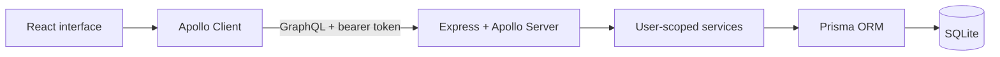

# Financy

Financy is a full-stack personal finance application built for a challenge in Rocketseat's Tech Developer 360 postgraduate program. It brings account management, categories, and income and expense transactions into a single dashboard.

The repository brings together a GraphQL backend and a React frontend, with user-scoped data access and a local SQLite database. It was developed as an academic challenge.

## What it does

- Registers users and signs them in with JWT-based authentication.
- Creates, lists, edits, and deletes categories and transactions through a GraphQL API.
- Scopes category and transaction operations to the authenticated user. Transaction creation and category changes also verify category ownership.
- Shows balance, income, expenses, recent transactions, and category summaries on the dashboard.
- Filters transactions by title, type, category, and month, with client-side pagination.
- Lets users choose a category icon and color and update their profile name.
- Loads main routes lazily and uses Apollo Client caching policies for data fetching.

## Stack

| Layer | Technology |
| --- | --- |
| API | Node.js, TypeScript, Express 5, Apollo Server, TypeGraphQL |
| Data | Prisma, SQLite |
| Authentication | bcryptjs, JSON Web Tokens |
| Web | React 19, Vite, TypeScript, Apollo Client, React Router |
| UI and state | Tailwind CSS, shadcn/ui components, Zustand, React Hook Form, Zod |

## Architecture



Authentication identifies the current user; service queries use that identity to scope category and transaction access. The frontend handles transaction filtering and pagination after retrieving the user's data.

## Project layout

```text
backend/   GraphQL API, Prisma schema, and migrations
frontend/  React application
```

## Run locally

You will need Node.js and pnpm. Install dependencies separately in `backend/` and `frontend/`.

1. In `backend/`, copy `.env.example` to `.env`. Set `DATABASE_URL` to a local SQLite URL (the example uses `file:./dev.db`) and replace `JWT_SECRET` with your own secret.
2. From `backend/`, run:

   ```bash
   pnpm install
   pnpm exec prisma migrate dev
   pnpm exec prisma generate
   pnpm dev
   ```

3. In `frontend/`, copy `.env.example` to `.env`. Set `VITE_API_URL=http://localhost:4000/graphql`, then run:

   ```bash
   pnpm install
   pnpm dev
   ```

Open the URL shown by Vite, normally `http://localhost:5173`. The API listens at `http://localhost:4000/graphql`. The development server currently allows requests from `http://localhost:5173` through its CORS configuration, so use that origin when running locally.

## Challenge context and implementation

The challenge called for a personal finance application with a React and GraphQL frontend, a TypeScript and GraphQL backend, Prisma with SQLite, JWT authentication, and user-owned categories and transactions. My implementation follows that brief. The implementation also includes: richer category metadata (description, icon, color), a profile-name mutation, transaction filters and pagination, route-level lazy loading, and interface improvements such as category styling and feedback toasts.

## Development checks

The frontend defines `pnpm build` (TypeScript and Vite) and `pnpm lint` (ESLint). The backend has no automated test script. The project currently has no automated test suite documented in its package scripts.
